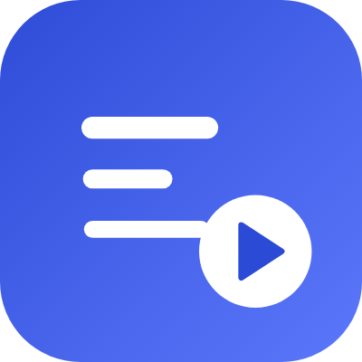

<p align="center"></p>

# Vidskim: YouTube MCP server

A hosted [Model Context Protocol](https://modelcontextprotocol.io) server that lets Claude, ChatGPT, Claude Code, Cursor, VS Code, and other MCP clients read YouTube videos. It returns full transcripts with chapters and a clickable timestamp on every paragraph, so the assistant answers from what was actually said and you can check each claim in one click.

```
https://vidskim.com/api/mcp
```

Remote server, Streamable HTTP, OAuth 2.1 with dynamic client registration. Nothing to install, no API key: paste the URL and sign in with Google.

Website and docs: [vidskim.com/mcp](https://vidskim.com/mcp) · Registry: `com.vidskim/youtube` · Listed in the [Claude connector directory](https://claude.ai/directory/vidskim)

## Tools

| Tool | What it does |
|---|---|
| `get_transcript` | Full transcript in Markdown with chapters and a timestamp link on every paragraph. Long videos come in parts; any time range can be read on its own; YouTube's machine translation is available for other languages. |
| `search_transcript` | Finds the passages about a topic inside one video. |
| `get_video_info` | Title, channel, date, views, description, and chapters. |
| `search_youtube` | Finds videos by topic when you don't have a link yet. |
| `list_channel_videos` | A channel's latest uploads, or the videos in a playlist. |

All tools are read-only. Vidskim never posts, comments, or touches your YouTube account.

## Connect

### Claude (claude.ai, Desktop, mobile)

Vidskim is listed in the Claude connector directory. Open [claude.ai/directory/vidskim](https://claude.ai/directory/vidskim), click **Connect to Claude**, sign in with Google, and press **Allow**.

Or add it as a custom connector:

1. Open **Settings → Connectors** and choose **Add custom connector**.
2. Name it **Vidskim** and paste `https://vidskim.com/api/mcp`.
3. Click **Connect**, sign in with Google, and press **Allow**.

Tip: choose **Always allow** for the Vidskim tools the first time Claude asks, so long videos (which arrive in several parts) don't ask again for every part.

### ChatGPT

1. Open **Settings → Apps & Connectors → Advanced** and turn on **Developer mode**.
2. Back in **Apps & Connectors**, click **Create**, name it **Vidskim**, paste the URL, and pick **OAuth**.
3. Sign in with Google, press **Allow**, then turn Vidskim on in a chat from the **+** menu.

### Claude Code

```bash
claude mcp add --transport http vidskim https://vidskim.com/api/mcp
```

Then type `/mcp` inside Claude Code, pick **vidskim**, and sign in.

### Cursor

Add to `~/.cursor/mcp.json`:

```json
{
  "mcpServers": {
    "vidskim": { "url": "https://vidskim.com/api/mcp" }
  }
}
```

Cursor opens the sign-in the first time a tool runs.

### VS Code

```bash
code --add-mcp '{"name":"vidskim","type":"http","url":"https://vidskim.com/api/mcp"}'
```

Start the server from the MCP view and sign in when Copilot asks.

### Any other MCP client

Add a remote MCP server with the **Streamable HTTP** transport and the URL above. Authentication is standard OAuth 2.1 with dynamic client registration.

## Example

> Explain how this video says a transformer works, in a few short points with timestamps: https://youtu.be/wjZofJX0v4M

> - A chatbot works by predicting a probability distribution for the next chunk of text, sampling from it, and repeating [2:01](https://youtu.be/wjZofJX0v4M?t=121).
> - The input is split into tokens, and each token becomes a vector meant to encode its meaning [3:04](https://youtu.be/wjZofJX0v4M?t=184).
> - In the attention block those vectors pass information to each other [4:05](https://youtu.be/wjZofJX0v4M?t=245).

## Limits

- Works with public YouTube videos that have captions, uploaded or auto-generated, in any language. Videos with no captions, private, members-only, or removed videos return a clear message instead of a guess.
- A transcript is speech only: slides and on-screen text are missing unless the speaker reads them out.
- Free plan: 30 videos a month. Each video counts once, so follow-up questions and searches inside it don't use more.

## Privacy and support

- Privacy policy: [vidskim.com/privacy](https://vidskim.com/privacy)
- Support: [vidskim.com/support](https://vidskim.com/support)

This repository holds the listing files for MCP directories (this README and `server.json`). The server itself is hosted at vidskim.com.

Vidskim is independent and is not affiliated with, endorsed by, or sponsored by YouTube, Google, Anthropic, or OpenAI.
